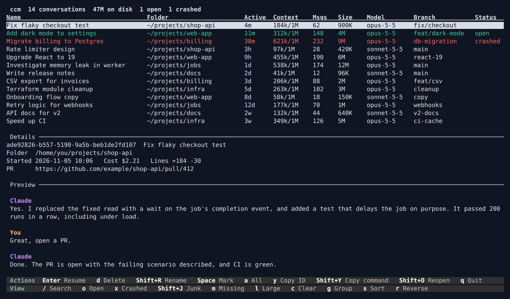

# ccm

**A terminal app for finding, resuming and cleaning up your Claude Code conversations.**



*The conversations in this screenshot are examples.*

## Why

If you run a lot of Claude Code sessions, they pile up:

- Finding an old conversation means remembering when and where it ran, or what it was called.
- Claude Code can purge a whole project, but not one conversation and everything stored with it.
- After a crash or reboot, nothing tells you which conversations were open or which folders they ran in.

`ccm` puts every conversation from every project in one table, with full-text search and a preview. It only uses the files Claude Code already keeps, and it opens in a fraction of a second, even with hundreds of conversations.

## What you can do

- **Browse:** see every conversation's folder, age, context used, messages, size, model, branch and status.
- **Search:** find a conversation by anything said in it.
- **Preview:** read the latest messages and scroll back, without opening the conversation.
- **Resume:** open it in a new terminal, in the folder it ran in. Inside `herdr-app`, it opens in that folder's workspace.
- **Fork:** start a new conversation as a copy of one, to try another direction while the original stays as it was.
- **Delete:** permanently remove one or many conversations and their data, after a confirmation that lists what goes.
- **Rename:** the new name also shows in Claude Code's own `/resume`.
- **Group:** by the folder a conversation ran in, or by Git repository, so the work in a repository and all its worktrees shows together.
- **Clean up:** one screen lists what could be cleaned up and how much space it would free, and deletes it after asking: conversations Claude never replied to, ones whose folder is gone, large ones you haven't used for a while, worktrees nothing needs, and leftover background job folders.
- **Recover:** after a crash, see what was running and reopen it all at once.
- **Worktrees:** see the Git worktrees of the repositories your conversations used, with their uncommitted changes, unpushed commits and the conversations that worked in each, and remove the ones you're done with.
- **Web version:** everything above in a browser, on this computer only. See [Web version](#web-version).
- **Codex:** Codex conversations show in the same list, and can be searched, previewed, resumed, forked, renamed and deleted. See [Codex](#codex).

## Install

You need [Claude Code](https://claude.com/claude-code). On Linux or macOS, run:

```sh
curl -fsSL https://raw.githubusercontent.com/nunoaleixogoncalves/ccm/main/install.sh | sh
```

This downloads the ready-made program for your system from the [latest release](https://github.com/nunoaleixogoncalves/ccm/releases/latest), checks its checksum and puts it in `~/.local/bin`. To use another folder, set `CCM_INSTALL_DIR`. The script tells you if that folder isn't on your `PATH`. You can [read the script](install.sh) first, or download the program from the releases page yourself.

It then runs `ccm setup`, which shows the changes it would make to Claude Code's settings and applies them only if you answer `y`. Those changes are only needed for crash recovery and exact context window sizes. Everything else works without them.

The Linux programs are static, so they work on any distribution. The macOS ones aren't signed: installing with the command above is fine, but macOS may refuse one you download with a browser until you allow it in **System Settings → Privacy & Security**.

### Trying the beta

`2.0.0-beta` is a pre-release, so the command above still installs the last stable version. To install the beta instead:

```sh
curl -fsSL https://raw.githubusercontent.com/nunoaleixogoncalves/ccm/main/install.sh | CCM_RELEASE_URL=https://github.com/nunoaleixogoncalves/ccm/releases/download/v2.0.0-beta sh
```

Codex support is new and is still being tested with real Codex conversations. To go back to the stable version, run the install command above.

### Build from source

You need Git, [Rust](https://rustup.rs) (current stable) and a C compiler to build the bundled SQLite. Open a new terminal after installing Rust, so `cargo` is found.

| System | C compiler |
|---|---|
| macOS | `xcode-select --install` |
| Arch, Omarchy | `sudo pacman -S --needed base-devel` |
| Debian, Ubuntu | `sudo apt install build-essential` |
| Fedora | `sudo dnf install gcc` |

```sh
git clone https://github.com/nunoaleixogoncalves/ccm.git
cd ccm
./install.sh
```

If you use mise, install with this script and not `cargo install`. `cargo install` puts `ccm` where mise creates a shim that fails outside this repository.

### Optional tools

| Tool | What it's for | Without it |
|---|---|---|
| `wl-copy` or `xclip` | Copying on Linux | `ccm` asks your terminal to copy, which not every terminal allows |
| `xdg-terminal-exec` | Resuming in a new terminal on Linux, outside WSL | Set `terminal` in the [configuration](#configuration), or run the command `ccm` shows you |
| Windows Terminal | Resuming in a new tab on WSL | The same as above |
| Git 2.36 or later | The [worktree view](#worktrees) and [grouping by repository](#grouping) | The view says Git wasn't found, and conversations stay grouped by folder |

## Update

Run the install command again. `ccm --version` shows which version you have, and the [changelog](CHANGELOG.md) what changed in each.

If you built from source, run this from the repository folder instead:

```sh
git pull
./install.sh
```

## Usage

Run `ccm` from anywhere.

| Command | What it does |
|---|---|
| `ccm` | Opens the list |
| `ccm web` | Opens the list in a browser. See [Web version](#web-version) |
| `ccm setup` | Installs the hooks crash recovery needs, after showing the changes |
| `ccm --help` | Shows the commands |
| `ccm --version` | Shows the version |

`ccm hook` and `ccm hook status-line` are also there, but Claude Code runs those. You won't need to.

### Keys

Most keys are also buttons in the footer, so you can click them. The footer splits them into **Actions**, which do something to a conversation, and **View**, which only change what the list shows.

Moving around:

| Key | What it does |
|---|---|
| Up, Down, or `k`, `j` | Move the selection |
| Page Up, Page Down, Home, End | Move further |
| `[`, `]` | Scroll the preview back and forward |

Actions:

| Key | What it does |
|---|---|
| Enter | Resume the selected conversation |
| `f` | Fork it. See [Forking](#forking) |
| `d` or Del, then `y` or Del | Delete the selected or marked conversations. You can also click Delete twice. A second Del needs a moment's pause, so holding the key can't delete anything |
| `m`, while confirming a delete | Choose whether to delete memory notes too. It only appears when there are notes to delete |
| `w`, while confirming a delete | Choose whether to remove the worktrees only those conversations used. It only appears when there's one to remove. See [Removing a worktree with its conversation](#removing-a-worktree-with-its-conversation) |
| `Shift+R` | Rename |
| Space | Mark or unmark, then move to the next row |
| `a` | Mark everything shown, or clear those marks |
| `y` | Copy the conversation's ID |
| `Shift+Y` | Copy the command that resumes it |
| `Shift+O` | Open the list of crashed conversations to reopen |
| Esc | Clear the marks, then the search. It never quits |
| `q`, Ctrl-C | Quit |

View:

| Key | What it does |
|---|---|
| `/` | Search. Enter keeps the results, Esc clears them |
| `o` | Show only open conversations |
| `x` | Show only crashed conversations |
| `Shift+J` | Show only junk, meaning conversations Claude never replied to |
| `m` | Show only conversations whose folder is missing |
| `l` | Show only large conversations |
| `t` | Show only one tool's conversations, one tool after another. Only there when [Codex](#codex) conversations are found too |
| `c` | Clear the filters |
| `g` | Group by folder, then by repository, then not at all. See [Grouping](#grouping) |
| `s` | Change the sort column |
| `r` | Reverse the sort |
| `w` | Show the [worktrees](#worktrees). `w` or Esc goes back |
| `Shift+C` | Show the [clean-up suggestions](#cleaning-up). `Shift+C` or Esc goes back |

With the mouse, you can click a row to select it, double-click to resume, click a column heading to sort, and use the wheel to scroll.

## Cleaning up

Press `Shift+C` to see what could be cleaned up. Each line says how many items it found and how much space removing them would free:

- conversations Claude never replied to
- conversations whose folder is gone
- conversations over the large size, 100 MB by default, that haven't been active for 30 days
- worktrees no conversation worked in that have nothing to lose: no uncommitted changes, no unpushed commits and a branch, or a folder that's already gone. Locked ones, and ones a running session is in, aren't suggested
- background job folders in `~/.claude/jobs` whose conversation is gone, that haven't changed for a day and aren't running

Open conversations are never suggested, and `ccm` never brings this screen up by itself.

- `d` or Del deletes everything on the selected line. To delete several lines at once, mark them with Space (`a` marks every line with something in it) and press `d`. One confirmation lists each line and everything that would go, and a conversation found on two lines is deleted once. Each one is checked again just before it goes, as with any delete. Worktrees are removed with `git worktree remove` and their branches are kept. One that has gained unpushed commits since is skipped, so remove it from the worktree view.
- Enter or a double-click opens a line to look through it or delete only some. A conversation line opens the list showing just those conversations, and `c` clears it like any filter. The worktree line opens the worktree view showing just those worktrees, and `c` shows all of them again. The job line lists the folders.
- A job that may have a worktree is never deleted by `ccm`, because `claude rm` is what removes its worktree safely. Open the job line with Enter and press `c` to copy the `claude rm` commands.

Change what counts as large or old with `large_threshold_mb` and `old_after_days` in the [configuration](#configuration).

## Forking

Press `f` to start a fork of the selected conversation. It's Claude Code's own fork (`claude --resume <id> --fork-session`): a new conversation that starts with a copy of the whole history, while the original stays as it was.

- It opens like a resume: in a new terminal, or in `herdr-app`, in the folder the conversation started in. Claude Code looks for the original there, so it can't start anywhere else.
- It's named after the original with "(fork)" added. Rename it with `Shift+R` as usual.
- You can fork an open conversation. The original carries on untouched.
- Claude Code records no link between a fork and its original, so `ccm` picks the fork's ID and keeps its own log of the forks it starts. The details panel shows "Forked from" on a fork and "Forks" on the original.
- The fork shows in the list once Claude Code saves it, which may be only after you send it a first message. `ccm` then selects it.
- Deleting either one leaves the other alone.

## Grouping

Press `g` once to group conversations by the folder they started in, and again to group them by Git repository. A third press turns grouping off.

- A repository's group holds the conversations that started in its main folder and in any of its worktrees. It's named by the main folder.
- Each conversation shows its branch, and its worktree when that isn't the main folder, as in `Fix the login form [login-fix · shop-login]`.
- `ccm` asks Git which repository each folder belongs to, once per folder, and keeps the answer. A worktree you remove later stays in its repository's group. Folders that weren't in a repository are asked about again each time you pick repository grouping.
- A folder that's gone and was never seen in Git goes to the repository whose folder contains it, as with `.claude/worktrees`. Otherwise it gets its own group, marked "folder gone". Folders outside Git keep their own groups, marked "not in Git".
- Until Git answers, which usually takes a fraction of a second, conversations stay grouped by folder.

## Worktrees

Press `w` to see the Git worktrees of every repository a conversation worked in. Each one shows its folder, branch, uncommitted changes, unpushed commits and how many conversations worked in it, and the panel below lists those conversations.

- `ccm` asks Git which folders are worktrees, so it finds them wherever they are, including beside the main repository. A repository's main worktree isn't listed.
- A conversation counts as having worked in a worktree if it was in that folder, or a folder inside it, at any point. Conversations often change folder, so the list says how recently each one was there, how much of its activity happened there, and whether it started or stopped there.
- Unpushed commits are the ones on no remote branch. In a repository without a remote, they're the ones on no other branch. Remote branches are as of your last fetch, because `ccm` never uses the network. When a branch's remote branch was deleted, its commits count as unpushed, and the details say it was probably merged.
- `ccm` checks Git again each time you open the view, then every 20 seconds while it's open.

The keys work like the conversation list: Space marks, `a` marks everything, Esc clears the marks and then goes back, and `d` or Del removes the selected or marked worktrees after a popup. Confirm with `y` or Del, or click Remove twice.

Removing runs `git worktree remove`, never with `--force`. The branch stays, so its commits are kept. Everything is checked again just before each removal, and a worktree is refused if:

- it has uncommitted changes
- a commit is checked out directly and some of its commits are on no branch, because nothing would keep them
- a conversation is open in it, or an open one was last working in it
- a conversation that worked in it was written to in the last minute, or runs in the background
- a background job may own it, which `claude rm` removes instead
- it's locked or has submodules, which Git won't remove either
- Git couldn't read its state, or a running session's registry file can't be read
- it was made by Git for Windows. On WSL, Git can't reach a folder recorded as `C:/...`, so it calls the worktree missing even when it exists. `ccm` shows it as "Windows" and leaves it alone

Unpushed commits don't stop a removal, because the branch keeps them. They are only on your machine, though, so the popup warns about them in red. **Remove stays locked for 5 seconds**, with a countdown, and pressing `y`, Del or Remove before it ends starts it over. If more commits appear after you confirm, that worktree is skipped.

The popup lists the conversations that worked in each worktree. It also warns when a conversation started there, because resuming that conversation later recreates the folder empty. **Files Git ignores, such as `.env` or build output, are deleted with the worktree.** The popup lists them with their size, and if new ones appear after you confirm, that worktree is skipped.

### Removing a worktree with its conversation

When you delete a conversation from the list, the popup also shows the worktrees nothing else used, and `w` adds them to the delete. They're kept unless you press it.

- A worktree is offered when a deleted conversation started there or was last working there, and no other conversation was ever there, even briefly. One the conversation only passed through stays, and shows on the [clean-up screen](#cleaning-up) once nothing is connected to it.
- The rules above apply: the same refusals, the same check just before it goes, and the same warning and 5-second countdown for unpushed commits. A worktree that can't go is listed with the reason, and doesn't stop the delete.
- The conversations go first. A worktree stays if one of its conversations couldn't be deleted.

## Codex

`ccm` also lists [Codex](https://github.com/openai/codex) conversations, from `~/.codex/sessions`, or from `CODEX_HOME` if that's set. When both tools have conversations, a Tool column says which one each belongs to, and `t` shows one tool at a time.

Only conversations you typed in are listed. Runs of `codex exec`, and the conversations Codex starts for itself, such as subagents and reviews, are left out. A name you gave with `/rename` in Codex is shown.

Codex conversations can be resumed, forked and deleted, through Codex's own commands, so the `codex` command must be installed:

- **Resume** runs `codex resume -C <folder> <id>` in a new terminal, the same way as for Claude Code. `-C` keeps Codex from asking which folder to use.
- **Fork** runs `codex fork -C <folder> <id>`. Codex gives the fork its own ID and records which conversation it came from, and `ccm` shows that.
- **Delete** runs `codex delete --force <id>`. That also clears the records Codex keeps of the conversation in its own databases. Codex refuses to delete a conversation that's running, or one a fork still needs, and `ccm` shows its reason. Then `ccm` takes the conversation's prompts out of Codex's `history.jsonl`, which `codex delete` leaves, holding the same lock Codex uses for that file.

**Open and crashed** need no setup for Codex. A running Codex holds a lock on `thread-writer-locks/<id>.lock` in its folder and removes the file when it finishes, so a held lock shows the conversation as open, and a file nobody holds shows it as crashed. `ccm` checks this the way Codex itself does, under Codex's `.coordination.lock`, and never creates or removes these files. Codex clears files left by a crash the next time it starts.

**Rename** works the way Codex's own `/rename` does: one more line in `session_index.jsonl`, written while holding Codex's `session_index.jsonl.lock`, and Codex shows the newest one. An open conversation is renamed from Codex itself. So is one using Codex's opt-in paginated history, which keeps names in Codex's database. Files Codex compressed (`.jsonl.zst`) aren't read yet.

## Web version

`ccm web` shows the same list in a browser: search, filters, sorting, grouping and the preview, with the same keys. It updates by itself, and can run alongside the terminal app.

Resume and fork open a terminal on this computer, the same way the terminal app does. If that fails, the page gives you the command to copy. Rename, copying the ID or command, reopening after a crash and deleting work as they do in the terminal, under the same rules. The delete popup lists what goes and offers the same worktrees, and the wait for unpushed commits is enforced by `ccm` itself, not the page.

The worktree view (`w`) and the clean-up screen (`Shift+C`) are there too, with the same checks and the same keys.

It opens your browser and prints a link, then runs until you press `Ctrl+C`.

| Option | What it does |
|---|---|
| `--port N` | Uses this port instead of a free one |
| `--no-browser` | Only prints the link |

It's for this computer only:

- It only accepts connections from this computer, and only at the address it printed.
- The link holds a secret that works once and is swapped for a cookie, so the page keeps working in that browser until `ccm web` stops. To use another browser, start `ccm web` again.
- It refuses requests that other websites try to send it.
- Conversation text is always shown as plain text, and the page loads nothing from anywhere else.

On another computer over SSH, forward the same port on both sides, such as `ssh -L 9000:127.0.0.1:9000`, and run `ccm web --port 9000 --no-browser`.

## Configuration

Everything is optional. The file is `~/.config/ccm/config.toml`:

```toml
# What counts as large for the l filter and clean-up, in MB. The default is 100.
large_threshold_mb = 200

# Days without activity after which a large conversation is suggested for
# clean-up. The default is 30.
old_after_days = 60

# The command that opens a terminal. "claude --resume <id>" is added to the end,
# and it runs in the conversation's folder. The default is xdg-terminal-exec, or
# Windows Terminal on WSL.
terminal = ["foot", "-e"]

# Which tools to read: "claude", "codex" or both. By default, every tool whose
# folder exists is read.
tools = ["claude", "codex"]

# Context window sizes by model, for models that show "?".
[windows]
claude-opus-4-8 = 200000
```

On macOS, set `terminal` to a terminal that can run a command, such as `["alacritty", "-e"]`. If no terminal can be started, `ccm` shows the command to run yourself, and why it couldn't.

On WSL, `ccm` opens a new Windows Terminal tab when `terminal` isn't set. It starts the conversation with `wsl.exe --cd`, so the folder is the Linux one. That tab runs `claude` directly, without your shell's startup files, so `ccm` passes the full path of the `claude` it finds and carries `CLAUDE_CONFIG_DIR` over if you set it. If Windows Terminal isn't found, it uses `xdg-terminal-exec` as on Linux.

## What it touches on your machine

`ccm` reads Claude Code's files in `~/.claude`, or in `CLAUDE_CONFIG_DIR` if that's set, and Codex's conversation files in `~/.codex/sessions` and its `session_index.jsonl`, or in `CODEX_HOME`. It only changes Codex's data through `codex delete`, plus the prompt history edit and the name line described in [Codex](#codex), and never opens its databases. It sends nothing over the network. [`ccm web`](#web-version) serves its page to this computer only.

While the [worktree view](#worktrees) is open, it runs Git in the repositories your conversations worked in. While [grouping by repository](#grouping), it asks Git which repository each folder belongs to. The [clean-up screen](#cleaning-up) runs the same Git checks as the worktree view, and measures the size of the worktrees it suggests. Only `git worktree remove` changes anything, and only after you confirm. It ignores `GIT_*` variables from its own environment, stops a repository's `core.fsmonitor` setting from running a program, takes no optional locks and never fetches.

It writes these files of its own:

| Path | What it holds |
|---|---|
| `~/.cache/ccm/index.db` | The search index, including a copy of conversation text, and the repository of each folder conversations started in. It's owner-only, and safe to delete because `ccm` rebuilds it |
| `~/.config/ccm/config.toml` | Your configuration, if you create one. `ccm` only reads it |
| `~/.local/state/ccm/sessions.jsonl` | When sessions start and end, as IDs and times only |
| `~/.local/state/ccm/forks.jsonl` | Which conversations are forks `ccm` started, and of which, as IDs and times only |
| `~/.local/state/ccm/launch.log` | Error messages from the last terminal `ccm` started, so a failure to start can say why. Emptied each time |
| `~/.local/state/ccm/windows/` | Each session's context window size |
| `~/.local/state/ccm/backups/` | Your original settings files, from before `ccm setup` changed them |

### What `ccm setup` changes

- `settings.json` gets a `SessionStart` and a `SessionEnd` hook that record when sessions start and end.
- `statusline.sh` gets two lines, a comment and a command, that save the context window size. If you don't use a `statusline.sh`, or `ccm` can't safely edit yours, it tells you what to add instead.

### What a delete removes

**A delete can't be undone.** `ccm` refuses to delete a conversation that's open, running as a background job, or written to in the last minute. It also stops if it can't tell, such as when a running session's registry file can't be read.

| | |
|---|---|
| **Removed** | The transcript and its folder of subagents and tool results, its file history, session environment, tasks, debug log and telemetry, its search index entry, and its finished background job's files |
| **Edited** | `history.jsonl` loses that conversation's lines, using Claude Code's own lock. A pasted-content file goes only if nothing else uses it |
| **Kept unless you press `m`** | Memory notes that only this conversation wrote |
| **Kept unless you press `w`** | The [worktree](#removing-a-worktree-with-its-conversation) only this conversation used |
| **Always kept** | Other conversations, including forks and continuations, plus memory notes edited by hand, `plans/`, the folder's trust setting, and a background job that may have a worktree, which `ccm` tells you to remove with `claude rm` |

A Codex conversation is deleted by Codex itself. See [Codex](#codex).

## Crash recovery

Claude Code records a clean exit, or a closed terminal, but it can't record a power loss or a hard kill. With the hooks installed, `ccm` shows a session that started and never ended as crashed, in red. Press `Shift+O` to choose which ones to reopen. Any you untick stop showing as crashed.

Only sessions started after `ccm setup` are tracked. Codex conversations need no setup; see [Codex](#codex).

## Platforms

| Platform | Status |
|---|---|
| Linux | Built and tested. Used in `foot`, GNOME Terminal and `herdr-app`, and it should work in most modern terminals |
| macOS | Built and tested on Intel and Apple Silicon by automated checks, but not yet used by hand |
| WSL | Works like Linux. Resuming opens a Windows Terminal tab, which hasn't yet been checked by hand |
| Windows | Not supported outside WSL |

`ccm web` has been used by hand in Chrome on Linux so far.

Tested with Claude Code 2.1.318. Claude Code's file format isn't documented and can change, so `ccm` skips anything it doesn't recognise and warns you rather than crashing.

## Security

To report a problem privately, see [SECURITY.md](SECURITY.md).

## Uninstall

1. Remove the `ccm` hook entries from `~/.claude/settings.json`, and the two lines mentioning `ccm` from `~/.claude/statusline.sh`.
2. Delete the program and its files:

```sh
rm ~/.local/bin/ccm
rm -rf ~/.cache/ccm ~/.config/ccm ~/.local/state/ccm
```

The last folder holds the backups of your settings, so copy them first if you want them. Your conversations aren't touched.

## License

[MIT](LICENSE)
